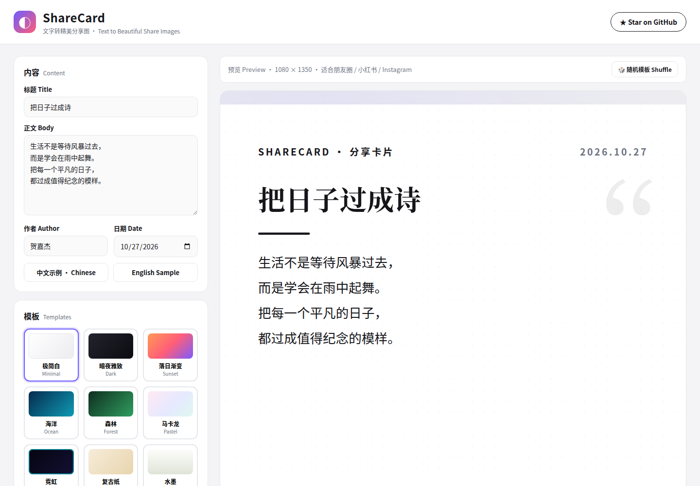
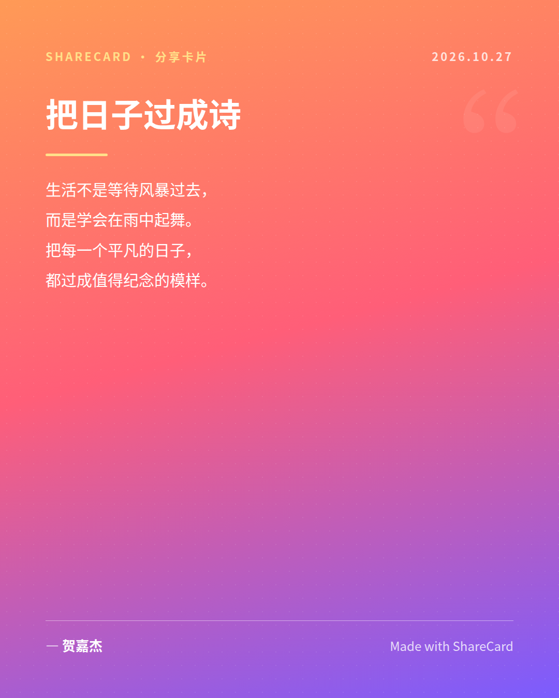
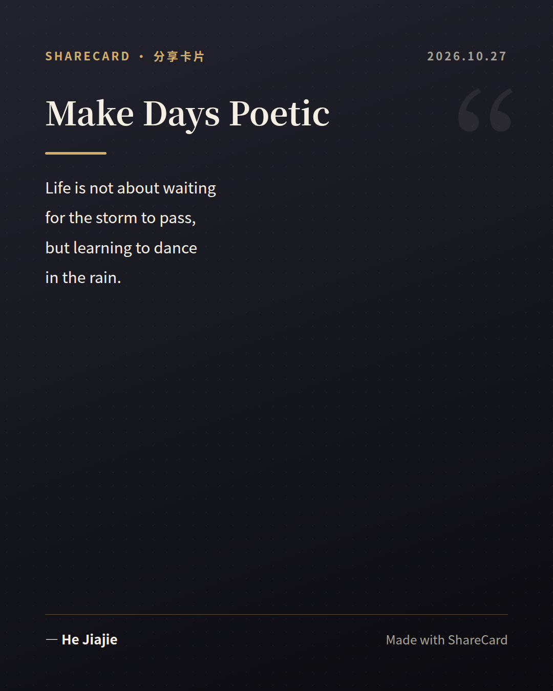
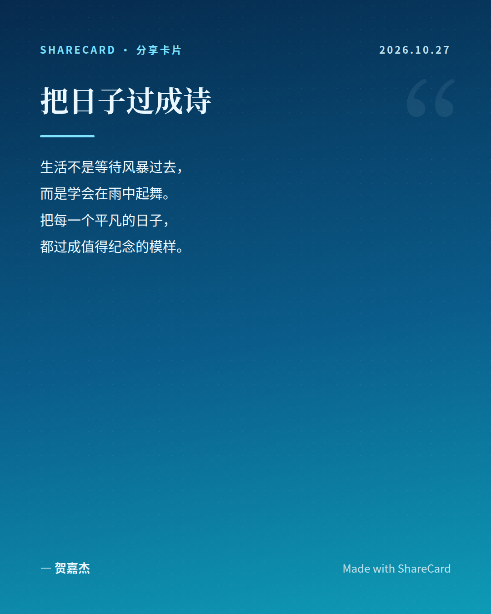

# ShareCard ✦ 文字转精美分享图

<p align="center">
  
  
  
  
  
</p>

<p align="center"><b>Turn your words into beautiful shareable images.</b><br>
Type a few lines, pick a template, export a stunning 1080×1350 card — ready for 朋友圈, 小红书, and Instagram. No sign-up, no server, no build step.</p>

<p align="center"><a href="https://e5ztvybe2w.github.io/sharecard/">🌐 Live Demo (GitHub Pages)</a> · <a href="#-quick-start">Quick Start</a> · <a href="#-templates">Templates</a></p>



---

## ✨ Features

- **📝 Live preview** — type and see your card update in real time
- **🎨 9 gorgeous templates** — Minimal, Dark, Sunset, Ocean, Forest, Pastel, Neon, Retro, Ink Wash
- **🎛️ Full styling control** — 8 accent colors, font size (24–40px), left / center / right alignment, background pattern & watermark toggles
- **🖼️ High-res export** — one click downloads a **2160×2700 (2x) PNG**, crisp on any screen
- **⚡ Zero setup** — a single `index.html`, no build tools, no backend; works offline (html2canvas is vendored in `vendor/`)
- **🌏 Bilingual UI** — Chinese + English labels throughout, with one-click Chinese / English sample texts
- **📱 Responsive** — comfortable on desktop and mobile
- **🔗 Shareable URLs** — `?template=sunset&sample=zh` opens the app pre-filled; `?shot=1` renders the card alone (great for automation)

## 🖼️ Example Cards

| Sunset · 落日渐变 | Dark · 暗夜雅致 | Ocean · 海洋 |
|---|---|---|
|  |  |  |

> `screenshots/card-export-demo.png` is a real PNG exported by the app (2160×2700).

## 🚀 Quick Start

**Option 1 — just open it**

```bash
git clone https://github.com/e5ztvybe2w/sharecard.git
cd sharecard
open index.html        # or double-click it — that's all
```

**Option 2 — GitHub Pages**

Settings → Pages → Deploy from branch → `main` → `/ (root)`. Your app is live at `https://e5ztvybe2w.github.io/sharecard/`.

**Use it**

1. Type a title, body, author (date fills itself in)
2. Pick a template, tweak colors / size / alignment
3. Click **导出高清 PNG · Export PNG** (or press `Ctrl/⌘ + S`)

## 🎨 Templates

| Template | 模板 | Vibe |
|---|---|---|
| Minimal | 极简白 | Clean serif, black on white |
| Dark | 暗夜雅致 | Near-black + gold, Playfair Display |
| Sunset | 落日渐变 | Orange → pink → violet gradient |
| Ocean | 海洋 | Deep blue gradient, airy white type |
| Forest | 森林 | Deep green + warm gold accent |
| Pastel | 马卡龙 | Soft pink / lavender / mint |
| Neon | 霓虹 | Black + cyan glow |
| Retro | 复古纸 | Cream paper, vermilion seal stamp |
| Ink Wash | 水墨 | Ink-brush serif, generous whitespace |

## 🛠️ Tech Stack

- **HTML + CSS + vanilla JS** — no framework, no bundler
- **[html2canvas 1.4.1](https://github.com/niklasvh/html2canvas)** — renders the card to a 2x PNG (vendored in `vendor/`, CDN fallback included)
- **Google Fonts** — Playfair Display, Inter, Noto Serif/Sans SC, Caveat (with system-font fallbacks, so the app still looks right offline)

## 🔧 URL Parameters

| Param | Example | Effect |
|---|---|---|
| `template` | `?template=ocean` | Open with a template pre-selected |
| `sample` | `?sample=en` | Pre-fill the English sample (`zh` by default) |
| `align` | `?align=center` | Pre-set text alignment |
| `shot` | `?shot=1` | Card-only mode (hides the editor — handy for screenshots) |
| `selftest` | `?selftest=1` | Headless export check; sets the page title to `EXPORT_OK 2160x2700` |

## 🤝 Contributing

Issues and pull requests are welcome! Ideas: more templates, custom background upload, multi-card batch export, quote API integration.

## 📄 License

MIT — see [LICENSE](LICENSE). Free for personal and commercial use.

---

# ShareCard ✦ 文字转精美分享图

<p align="center"><b>输入几行文字，得到一张好看的分享图。</b><br>
选个模板，一键导出 1080×1350 高清卡片，直接发朋友圈 / 小红书 / Instagram。无需注册、无需服务器、无需构建。</p>


## ✨ 功能

- **📝 实时预览** — 输入即所见，边打字边看效果
- **🎨 9 套精美模板** — 极简白、暗夜雅致、落日渐变、海洋、森林、马卡龙、霓虹、复古纸、水墨
- **🎛️ 自由调整** — 8 种强调色、字号 24–40px、左/中/右对齐、背景纹理与水印开关
- **🖼️ 高清导出** — 一键下载 **2160×2700（2 倍）PNG**，任何屏幕都清晰
- **⚡ 零配置** — 只有一个 `index.html`，无需构建、无后端；导出库已内置在 `vendor/`，离线也能用
- **🌏 双语界面** — 中英文对照，一键填入中文 / 英文示例
- **📱 自适应** — 桌面和手机都好用
- **🔗 可分享链接** — `?template=sunset&sample=zh` 直接打开预设好的卡片

## 🚀 快速开始

```bash
git clone https://github.com/e5ztvybe2w/sharecard.git
cd sharecard
open index.html        # 双击打开就能用
```

或用 GitHub Pages 部署：Settings → Pages → Deploy from branch → `main` → `/ (root)`。

**使用方法**：输入标题、正文、作者（日期自动填）→ 选模板、调颜色字号 → 点 **导出高清 PNG**（或按 `Ctrl/⌘ + S`）。

## 🛠️ 技术栈

- **HTML + CSS + 原生 JS** — 无框架、无打包
- **[html2canvas 1.4.1](https://github.com/niklasvh/html2canvas)** — 把卡片渲染成 2 倍 PNG（已内置于 `vendor/`，另有 CDN 备用）
- **Google Fonts** — Playfair Display、Inter、Noto Serif/Sans SC、Caveat（加载失败时自动用系统字体）

## 🤝 参与贡献

欢迎提 Issue 和 PR！可以做的方向：更多模板、自定义背景上传、批量导出、接入名言 API。

## 📄 开源协议

MIT — 详见 [LICENSE](LICENSE)，个人与商业使用均免费。
